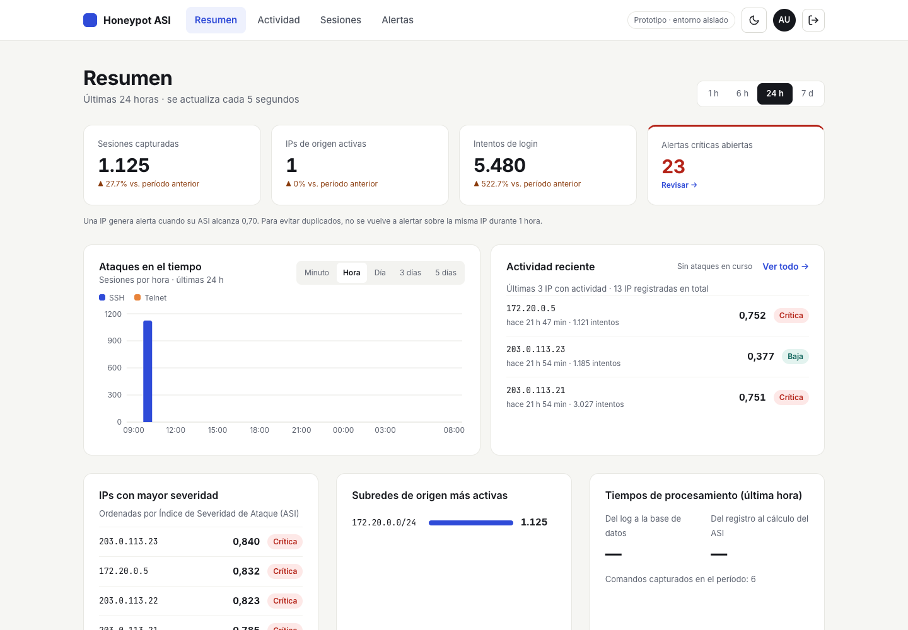
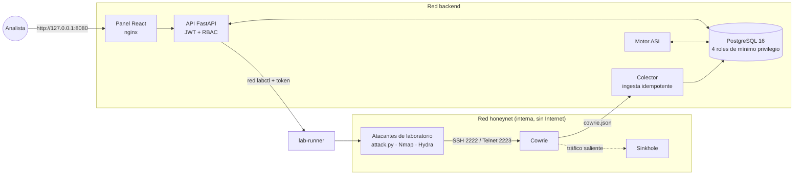

# Sistema de detección y análisis de ataques automatizados mediante señuelos de seguridad

Trabajo Final de Grado · Prototipado Tecnológico
**Licenciatura en Seguridad Informática · Universidad Siglo 21**
Autor: **Diego Rodrigo Soria** · Salta, noviembre de 2026



## Resumen

El trabajo diseña e implementa un prototipo de sistema de detección y análisis de ataques automatizados mediante señuelos de seguridad. El sistema integra cuatro piezas:

- un honeypot de interacción media ([Cowrie](https://github.com/cowrie/cowrie)) en un contenedor aislado;
- un pipeline que normaliza los eventos JSON del sensor y los guarda en PostgreSQL;
- un motor determinista que calcula un **Índice de Severidad de Ataque (ASI)** por dirección IP, en ventanas temporales deslizantes;
- una aplicación web con FastAPI y React.

Sobre un corpus sintético de 203.491 intentos, con umbral 0,70, el motor alcanzó **precisión 0,980, recall 1,000 y F1 0,990**. Estos resultados no reemplazan una validación con tráfico real, que queda pendiente.

**Palabras clave:** honeypot · Cowrie · detección de intrusiones · índice de severidad · ciberseguridad

## Problema

Las pequeñas y medianas organizaciones no pueden costear plataformas SIEM empresariales y les cuesta interpretar el volumen de registros que generan sus servicios expuestos a Internet. Ante miles de intentos de autenticación diarios, el analista sufre **fatiga de alertas** y no distingue el ruido de fondo de un ataque que merece atención.

Como caso de estudio se toma **Salta-Test S.A.S.**, una empresa ficticia de Salta que da soporte tecnológico e infraestructura cloud.

## Objetivo general

> Diseñar e implementar un prototipo de plataforma web de monitoreo y análisis de seguridad que integre un señuelo de seguridad (honeypot) con mecanismos de recolección, normalización, detección, clasificación y visualización de eventos, con el propósito de identificar y analizar patrones asociados a ataques automatizados contra servicios de red en un entorno controlado.

<details>
<summary><strong>Objetivos específicos</strong></summary>

1. Investigar el estado del arte y los marcos normativos sobre despliegue de señuelos de seguridad, técnicas de evasión de atacantes y métodos de detección de eventos automatizados en redes IP.
2. Identificar y caracterizar los patrones de tráfico más comunes asociados a herramientas de fuerza bruta, escaneo de puertos y enumeración de usuarios contra servicios SSH y Telnet.
3. Diseñar una arquitectura de software modular, segura y escalable que desacople el sensor de captura, la base de datos relacional, la lógica de detección y la interfaz de usuario.
4. Implementar y configurar una instancia del honeypot Cowrie en un contenedor aislado, restringiendo sus capacidades de interacción para mitigar riesgos operativos de pivoteo.
5. Construir un pipeline de ingestión que normalice los eventos JSON emitidos por el sensor hacia un esquema relacional unificado en PostgreSQL.
6. Programar un motor de detección basado en reglas heurísticas orientadas a correlacionar eventos por dirección IP, ventanas temporales y patrones de credenciales.
7. Diseñar un modelo algorítmico determinista para el cálculo del Índice de Severidad de Ataque (ASI), cuantificando la agresividad del tráfico hostil a partir del análisis de parámetros de volumen, frecuencia, persistencia temporal y diversidad de credenciales empleadas.
8. Desarrollar una aplicación web interactiva con React y FastAPI que provea tableros de control, explorador de eventos históricos y visualización de alertas tempranas.
9. Elaborar un banco de pruebas de ataque automatizado (utilizando herramientas como Nmap, Hydra y scripts propios) para generar tráfico hostil sintético en el laboratorio.
10. Evaluar cuantitativamente la precisión, exhaustividad y latencia de respuesta del motor de clasificación mediante el cálculo de la matriz de confusión.
11. Sintetizar los hallazgos experimentales, identificando cuellos de botella de la arquitectura y delineando las pautas para su evolución hacia entornos de producción.

</details>

## Qué hace el prototipo

| Funcionalidad | Descripción |
|---|---|
| **Captura** | Cowrie emula servidores SSH (puerto 2222) y Telnet (2223) y registra cada conexión, credencial probada y comando tipeado. |
| **Ingesta idempotente** | Cada línea del log se identifica por su SHA-256 y se guarda una sola vez. El avance de lectura (checkpoint) se guarda en la misma transacción. |
| **Motor ASI** | Cada 30 s recalcula la severidad de cada IP de origen y genera una alerta solo cuando el ASI llega a 0,70 o más. No repite alertas de la misma IP durante 1 h. |
| **Panel web** | Resumen con indicadores, actividad reciente, detalle por IP con el ASI desglosado, reproducción de sesiones, gestión de alertas y su historial, modo claro y oscuro. |
| **Control de acceso** | Tres roles (Auditor, Responsable de seguridad, Administrador de infraestructura) con separación de funciones. El login se bloquea tras 5 intentos fallidos. |
| **Laboratorio de ataques** | Los escenarios de la tesis (script propio, Nmap, Hydra, Telnet) se lanzan desde el panel, en una red aislada y sin acceso al socket de Docker. |

## Índice de Severidad de Ataque (ASI)

```
ASI(IP) = 0,25·F + 0,30·V + 0,20·D + 0,25·P
```

| Componente | Mide | Normalización (saturación) |
|---|---|---|
| **F** · frecuencia | intentos por segundo | r_ref = 1 intento/s (F = 0 con menos de 5 intentos) |
| **V** · volumen | cantidad de intentos | N_ref = 100 |
| **D** · diversidad | pares usuario/contraseña distintos | K_ref = 20 |
| **P** · persistencia | tiempo entre el primer y el último intento | Δt = duración de la ventana |

Se evalúan dos ventanas, de 15 y 60 minutos, y se conserva el máximo. Con el valor redondeado a 3 decimales se clasifica así: **BAJA** < 0,40 · **MEDIA** 0,40–0,69 · **CRÍTICA** ≥ 0,70.

## Arquitectura



Decisiones de seguridad del diseño:

- **Contención:** Cowrie vive en una red Docker interna sin salida a Internet. El tráfico saliente termina en un sinkhole.
- **Mínimo privilegio en la base:** cuatro roles (`db_owner`, `cowrie_ingest`, `asi_engine`, `api_app`) con permisos por columna. La telemetría es de solo inserción y el historial de alertas lo mantiene un trigger.
- **Separación de funciones:** el administrador de infraestructura no ve la telemetría y los auditores no administran usuarios.
- **Laboratorio sin socket de Docker:** la API habla con un servicio propio (`lab-runner`) por una red dedicada y con un token. Ese servicio solo acepta una lista cerrada de escenarios.

## Tecnologías

| Capa | Tecnología |
|---|---|
| Señuelo | Cowrie 3.1.5 (imagen fijada por digest) |
| Base de datos | PostgreSQL 16 |
| Backend | Python 3, FastAPI, psycopg |
| Frontend | React 18, TypeScript, Vite, Recharts, React Router |
| Infraestructura | Docker Compose, nginx, redes internas aisladas |
| Ataques de prueba | Paramiko (script propio), Nmap, Hydra |
| Calidad | pytest (131 tests), Vitest + Testing Library (65 tests), ESLint, Prettier, prueba de humo de punta a punta |

## Resultados de la evaluación

Corpus sintético de 400 episodios y 203.491 intentos (semilla 42), dividido en calibración (200 IPs) y evaluación (200 IPs, disjuntas). Resultado con los pesos iniciales y el umbral 0,70 sobre el conjunto de evaluación:

| | Predicho crítico | Predicho no crítico |
|---|---:|---:|
| **Realmente crítico** | 100 | 0 |
| **No crítico** | 2 | 98 |

**Precisión 0,980 · Recall 1,000 · F1 0,990.** Los 2 falsos positivos son ráfagas breves de severidad media.

Latencia medida en el sistema en ejecución: ingesta de 1,4 ms en promedio, del log a la base.

El informe completo, con el barrido de umbral, la calibración de pesos y la matriz de 3 clases, está en [`resultados/informe.md`](resultados/informe.md). Las capturas del panel usadas en el documento están en [`resultados/capturas/`](resultados/capturas/).

## Puesta en marcha

Requisitos: Docker Desktop con 4 GB de RAM o más, y los puertos 8080, 2222 y 2223 libres.

```bash
git clone https://github.com/dsoria-844/Tesis-dsoria.git
cd Tesis-dsoria
./scripts/init-env.sh                              # genera .env con contraseñas aleatorias
docker compose up -d --build
docker compose --profile tools run --rm seed       # usuarios de demostración
docker compose --profile lab up -d lab-runner      # opcional: laboratorio de ataques
```

Abrí http://127.0.0.1:8080 e ingresá con `auditor@salta-test.local`, `responsable@salta-test.local` o `admin@salta-test.local`. La clave es el valor de `DEMO_PASSWORD` en `.env`.

Para una demo rápida, `./scripts/demo.sh` reproduce un log de ejemplo: en 1–2 minutos aparecen 4 alertas críticas. Para verificar el stack completo de punta a punta, corré `./scripts/smoke.sh`.

> **Solo laboratorio.** No exponer el honeypot a Internet.

## Estructura del repositorio

```
cowrie/         configuración del honeypot (userdb.txt)
db/init/        roles, esquema y funciones de PostgreSQL
services/app/   backend Python: colector, motor ASI, API y evaluación
services/web/   frontend React (app/, shared/, features/)
sinkhole/       destino del tráfico saliente de la red aislada
tools/          atacantes de laboratorio y lab-runner (tools/attacker)
scripts/        init-env, demo, smoke
resultados/     evaluación del motor ASI y capturas
docs/           guía técnica e imágenes
```

La **[guía técnica](docs/guia-tecnica.md)** detalla los escenarios de ataque, el laboratorio, los tests, los desvíos respecto del documento y las notas de macOS.

## Limitaciones

- La evaluación usa **datos sintéticos separables**: el F1 casi perfecto no demuestra el desempeño con tráfico real de Internet.
- El ASI se calcula por IP, así que un ataque distribuido con un intento por IP no se detecta.
- **No implementado** (solo diseño): TOTP, VPN y copias de seguridad automáticas.
